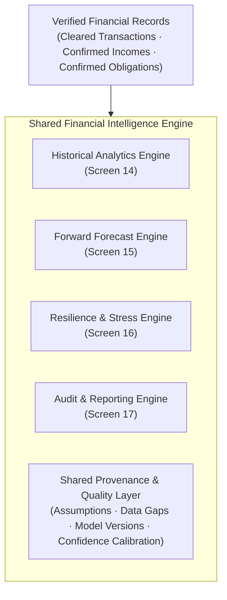

# Group C: Insights & Financial Intelligence Specification (Screens 14–17)

> **Parent Specification:** `docs/00_master_ui_specification.md`  
> **Status:** Approved with Mandatory Refinements Incorporated  
> **Platform:** Flutter Mobile (iOS & Android)  
> **Timeline Reference Anchor:** Today = Friday, 6 November 2026

---

## 1. Unified Financial Intelligence Data Layer

To prevent discrepancies across analytical screens, Screens 14, 15, 16, and 17 query a single centralized data layer:

---

## 2. Screen 14: Insights Overview (Refined)

- **Chart Title:** `"Monthly Income vs Expense Trend"` (covers Aug, Sep, Oct, Nov MTD).
- **Period Normalization:** November MTD is explicitly labeled with an annualized or prorated comparison tag (e.g., *"6 of 30 days recorded · Comparing against Oct 1–6 prorated"*), preventing misleading whole-month comparisons.
- **Outflow Cleanliness:** Category breakdown percentages compute strictly against net operational outflows, automatically excluding internal account transfers, credit card bill payments, and refunds.
- **Empirical Threshold:** Minimum 30 records and 45 days required before surfacing pattern correlations (e.g., weekend spending spikes).

---

## 3. Screen 15: Liquidity Forecast (Refined)

- **Prediction Interval Rigor:** Labeled explicitly as `"80% Prediction Interval"` with a tooltip explaining: *"Based on historical volatility, there is an estimated 80% likelihood that actual balances will fall within this envelope. This is not a guarantee of future balance."*
- **Model Metadata Header:** Displays `"Forecast generated: 6 Nov 2026, 06:00 AM · Data cutoff: 5 Nov 2026, 11:59 PM · Model: Prophet-Hybrid v2.1"`.
- **Confidence Calibration Indicator:** Replaces arbitrary percentages with an empirical calibration indicator: `"Model Status: Well-Calibrated (91% historical interval coverage over past 90 days)"`.
- **Trajectory-Driven Lowest Dip:** Automatically computed from minimum value of forward curve: `₹24,300` on 10 Nov (caused by Car Loan EMI ₹4,500 + baseline run-rate after House Rent cleared on 5 Nov).
- **Obligation State Distinction:**
  - `Cleared / Paid`: House Rent ₹12,000 (cleared on 5 Nov, visible in past actuals).
  - `Confirmed Upcoming`: Car Loan EMI ₹4,500 (due 10 Nov, factored into baseline).
  - `AI-Detected Candidate`: Streaming subscription ₹499 (excluded from baseline forecast until confirmed).
- **Interactive Risk Event Drawer:** Tapping a risk event reveals:
  - Exact contributing obligations.
  - Baseline daily burn rate applied.
  - Daily projected balance table with interval upper/lower bounds.
- **Insufficient Data Fallback State:** If user has logged < 14 days of data, screen presents a calibration placeholder: *"Building Forecast Model: 6 of 14 days recorded. Baseline daily burn estimated; forward prediction interval widened due to limited sample size."*

---

## 4. Screen 16: Financial Health (Refined)

- **Calibrated Qualitative Framing:** Evaluated as `"Your tracked finances currently show relatively strong liquidity resilience (Score: 78/100)"`, avoiding unvalidated claims of "insolvency probability".
- **Transparent Data Coverage for All 4 Pillars:**
  1. *Income Stability (92/100):* Based on 3 monthly payroll credits (variance: ±1.2 days). High reliability.
  2. *Expense Burden (68/100):* Committed obligations consume 47% of net income. High reliability.
  3. *Reserve Adequacy (84/100):* 2.3 months baseline liquid runway. Moderate reliability (cash accounts unobserved).
  4. *Cash-Flow Volatility (70/100):* Standard deviation in daily spend: ₹320. High reliability.
- **Credit Bureau Disclaimer:** Prominent notice: *"Internal liquidity metric. Not a CIBIL, Experian, or credit bureau score."*

---

## 5. Screen 17: Reports & Calibration (Refined)

- **Dual Accuracy Metrics:** Displays both **MAE (Mean Absolute Error)**: `₹1,240` and **Prediction-Interval Coverage**: `91%` (percentage of actual cleared balances falling inside the 80% envelope). MAPE is omitted when balances approach zero to prevent division artifacts.
- **Audit Metadata:** Includes Model Version (`v2.1`), Training Window (`Aug 1 – Oct 31, 2026`), Generation Date, and Data Cutoff.
- **Default Privacy:** Account number masking enabled by default (`•••• 4012`).
- **Export Presentation:** High-contrast executive print layout (crisp white background, dark grey typography).
