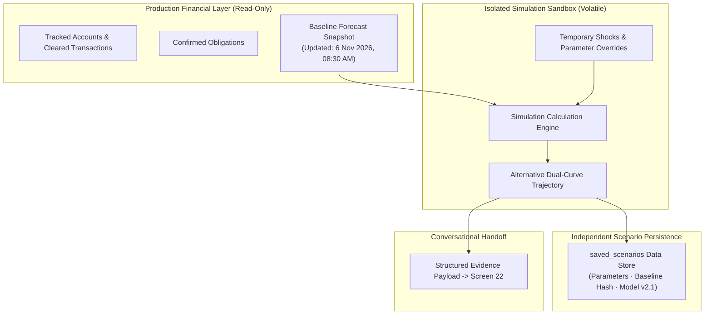

# Group D: Scenario Simulator UI Specification (Screens 18–20)

> **Parent Specification:** `docs/00_master_ui_specification.md`  
> **Status:** Approved with Mandatory Refinements Incorporated  
> **Platform:** Flutter Mobile (iOS & Android)  
> **Timeline Reference Anchor:** Today = Friday, 6 November 2026, 08:30 AM

---

## 1. Architectural Sandbox Isolation Boundary

The Scenario Simulator enforces a strict architectural boundary between production financial truth and hypothetical modeling:

### Sandbox Invariants
1. **Zero Database Contamination:** Simulations never write to production transaction tables or confirmed obligations.
2. **Persistent Visual Marking:** Every simulator screen displays:  
   `HYPOTHETICAL SIMULATION · No real accounts, transactions or obligations modified.`
3. **Saved Scenario Storage:** Stored in a separate `saved_scenarios` repository. Reopening a saved scenario checks if the baseline snapshot has changed and prompts: *"Baseline updated since last test. Recalculate against current cash position?"*

---

## 2. Screen 18: Simulator Home (Catalog & State Management)

- **Baseline Status Header:**
  - `Tracked Liquid Balance:` ₹42,850
  - `30-Day Lowest Dip:` ₹24,300 (10 Nov)
  - `Safety Buffer Threshold:` ₹15,000
  - `Available Buffer Margin:` +₹9,300
  - `Baseline Cutoff Timestamp:` `6 Nov 2026, 08:30 AM`
- **Scenario Tri-State History:**
  - `Saved Scenarios:` User-curated tests with recorded baseline snapshots.
  - `Recently Tested:` Temporary session history (volatile).
  - `Needs Recalculation:` Scenarios whose underlying baseline data has shifted.

---

## 3. Screen 19: Scenario Configuration (All 6 Scenario Types)

Every scenario type is fully parameterized with live baseline reference warnings:

| Scenario Type | Configurable Parameters | Dynamic Baseline Reference |
| :--- | :--- | :--- |
| **1. Unexpected Expense** | Outflow amount, Date, Category, Deducting account | Margin check: Informs user that outflows > ₹9,300 will breach safety buffer. |
| **2. Salary Delay** | Expected salary (₹35k), Scheduled date (1 Dec), Delay duration (5, 10, 15, 30 days) | Shift analysis: Maps delay window against obligations due between 1–10 Dec. |
| **3. New Recurring EMI** | Monthly payment, Start date, Tenure (6–36m), Deducting account | Cumulative burden: Projects long-term impact on monthly liquidity buffer. |
| **4. Income Cut** | Reduction magnitude (10%, 20%, 30%, custom), Start date, Duration | Burn rate stress: Re-evaluates baseline reserve runway. |
| **5. Rent Increase** | Current rent (₹12k), Revised rent, Effective date | Fixed commitment inflation: Re-indexes expense burden. |
| **6. Custom Multi-Variable** | Combine any combination of inflows, shocks, and expense reductions | Holistic cash-flow re-simulation. |

### Mitigation Assumption Editor
- Allows users to test counteracting measures:
  - Daily discretionary reduction amount (`₹/day`).
  - Active mitigation window (`Start Date` to `End Date`).
  - Target spending category (e.g. Dining, Entertainment).
- **Feasibility Validation:** System checks whether the user's historical spend in that category supports the proposed cut (e.g., cannot propose saving ₹500/day in dining if historical daily dining spend is ₹350/day).

---

## 4. Screen 20: Scenario Results (Comparative Engine)

### 4.1 Expanded Comparative Metrics

| Metric | Baseline Reality | Simulated Outcome | Mathematical Variance |
| :--- | :--- | :--- | :--- |
| **Lowest Projected Balance** | ₹24,300 (on 10 Nov) | ₹8,300 (on 12 Nov) | -₹16,000 (Deficit) |
| **Ending Balance (30 Days)** | ₹32,400 | ₹16,400 | -₹16,000 |
| **Safety Buffer Status** | Protected (+₹9,300) | BREACHED ⚠ | -₹6,700 below buffer |
| **Buffer Breach Amount** | ₹0 | ₹6,700 | Net shortfall |
| **Breach Duration** | 0 days | 12 days | Calculated by forecast engine |
| **Projected Recovery Date** | Not applicable | 24 Nov 2026 | Or *"Not recovered in horizon"* |

### 4.2 Dual-Trajectory Graph with Dual Prediction Intervals
- **Baseline Curve:** Solid line `#929292` enclosed in its grey 80% prediction interval.
- **Simulated Curve:** Solid line `#E5FF00` enclosed in its neon yellow 80% prediction interval.
- **Safety Buffer Line:** Horizontal dashed line `#FFAD55` (`₹15,000`).
- **Breach Zone:** Shaded red fill `rgba(255, 98, 108, 0.15)` bounded between the simulated curve and the buffer threshold during the deficit window.

### 4.3 Mathematically Calibrated Interactive Mitigations
- **Validated Calculation:** To eliminate a ₹6,700 deficit over 14 days, the required daily reduction is computed as `₹6,700 / 14 = ₹478.57/day` (~₹479/day).
- **Interactive Recalculation:** Tapping `[ Apply ₹479/day Discretionary Cut ]` immediately reruns the simulation engine and re-plots the simulated curve above the buffer threshold without altering real accounts.
- **Copilot Handoff:** Dedicated action `[ Ask Copilot to Optimize this Scenario → ]` serializes the simulation state into a structured JSON payload for Screen 22.
