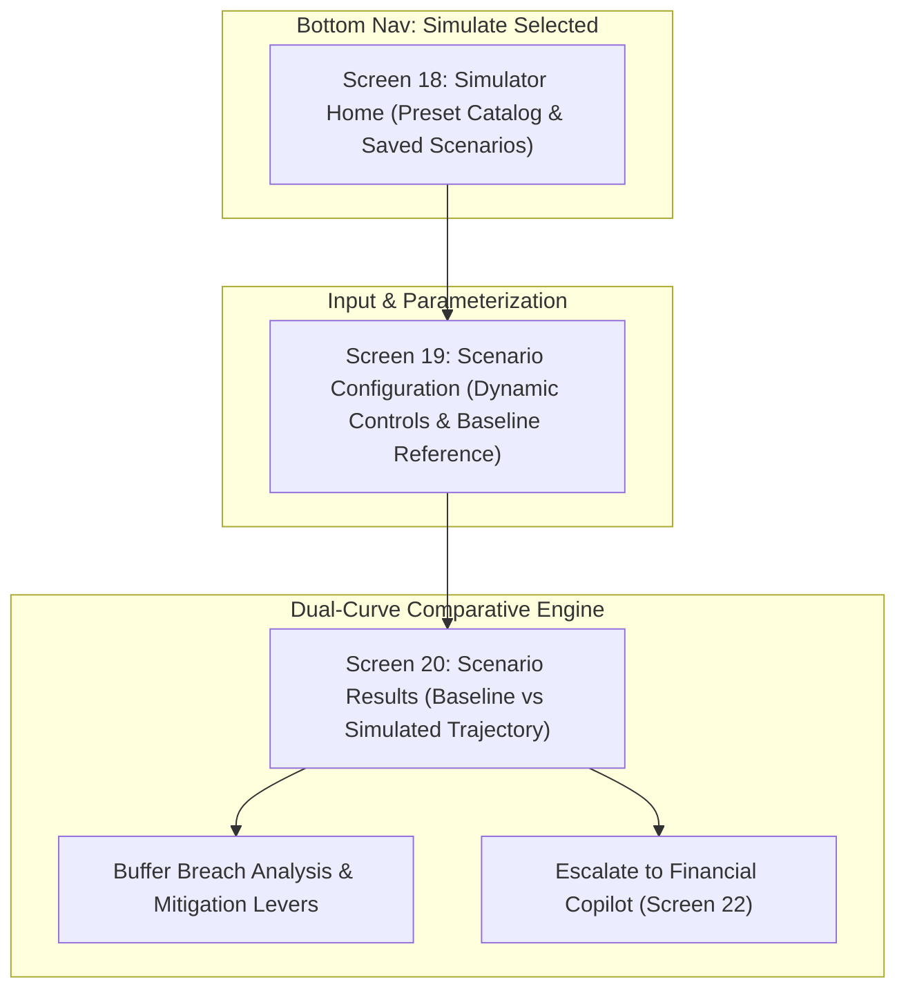

# Group D: Scenario Simulator UI Specification (Screens 18–20)

> **Parent Specification:** `docs/00_master_ui_specification.md`  
> **Status:** Specification Finalized  
> **Platform:** Flutter Mobile (iOS & Android)  
> **Core Principle:** Strict sandbox isolation. Hypothetical scenarios must never contaminate baseline financial records or verified forecasts.

---

## 1. Group D Architectural Flow



---

## 2. Screen 18: Simulator Home (Scenario Catalog)

> **Heading:** *"What if life happens?"*  
> **Subtext:** *"Test financial shocks and commitments before they impact your real cash balance."*

```
+--------------------------------------------------------------+
| Scenario Simulator                                   [Saved]|
+--------------------------------------------------------------+
| BASELINE LIQUIDITY CONTEXT                                   |
| +----------------------------------------------------------+ |
| | Liquid Balance: ₹42,850        30d Lowest Dip: ₹24,300   | |
| | Safety Buffer: ₹15,000         Buffer Clearance: +₹9,300 | |
| +----------------------------------------------------------+ |
|                                                              |
| EXPLORE SCENARIOS                                            |
| Select a shock to test how your liquidity absorbs it:       |
|                                                              |
| +----------------------------------------------------------+ |
| | [ ⚡ ] Unexpected Major Expense                           | |
| |       Simulate a one-time emergency (medical, repairs).   | |
| |       [ Start Simulation → ]                             | |
| +----------------------------------------------------------+ |
| | [ ⏳ ] Income / Salary Delay                               | |
| |       Test cash resilience if salary arrives 5–15d late.  | |
| |       [ Start Simulation → ]                             | |
| +----------------------------------------------------------+ |
| | [ 💳 ] New Recurring EMI / Subscription                    | |
| |       Evaluate long-term buffer impact of a new fixed bill.| |
| |       [ Start Simulation → ]                             | |
| +----------------------------------------------------------+ |
| | [ 📉 ] Income Cut / Freelance Drop                         | |
| |       Simulate 10%–30% temporary reduction in inflows.    | |
| |       [ Start Simulation → ]                             | |
| +----------------------------------------------------------+ |
| | [ 🏠 ] Rent or Essential Cost Increase                     | |
| |       Test inflation adjustments on existing commitments. | |
| |       [ Start Simulation → ]                             | |
| +----------------------------------------------------------+ |
| | [ 🛠 ] Custom Multi-Variable Scenario                     | |
| |       Combine multiple inflows, shocks, and expense cuts. | |
| |       [ Configure Custom → ]                             | |
| +----------------------------------------------------------+ |
|                                                              |
| SAVED SCENARIOS (Recent)                                     |
| • "MacBook Purchase (₹85k)" · Breached buffer · Tested 2 Nov |
+--------------------------------------------------------------+
```

---

## 3. Screen 19: Scenario Configuration

> **Purpose:** Allows users to adjust specific shock parameters while displaying live baseline anchors to ground expectations.

```
+--------------------------------------------------------------+
| [ ← Back ] Configure Scenario                        [Reset] |
| UNEXPECTED EXPENSE SHOCK                                     |
|                                                              |
| Expense Amount                                               |
|                        ₹ 16,000.00                           |
|                                                              |
| Date of Outflow                                              |
| [ 📅 Thursday, 12 Nov 2026 (in 6 days) ▼ ]                   |
|                                                              |
| Expense Category                                             |
| [ 🏥 Medical & Health ▼ ]                                    |
|                                                              |
| Deducting Account                                            |
| [ 💳 HDFC Salary Account (Balance: ₹42,850) ▼ ]              |
|                                                              |
| BASELINE LIQUIDITY REFERENCE                                 |
| +----------------------------------------------------------+ |
| | Baseline 30-Day Lowest Dip: ₹24,300 (on 10 Nov)           | |
| | Safety Buffer Threshold:    ₹15,000                        | |
| | Current Buffer Margin:      +₹9,300                        | |
| | Warning: An expense > ₹9,300 will breach your buffer!      | |
| +----------------------------------------------------------+ |
|                                                              |
| Mitigation Assumption (Optional)                             |
| [ ] Counteract by reducing discretionary spend by ₹300/day   |
|                                                              |
| [================ RUN SIMULATION & COMPARE ================] |
+--------------------------------------------------------------+
```

### Dynamic Input Templates by Scenario Type:
1. **Salary Delay:**
   - Pre-fills expected salary: `₹35,000` scheduled for `1 Dec`.
   - Slider / Pills for delay duration: `[ 5 Days ]` · `[ 10 Days ]` · `[ 15 Days ]` · `[ 30 Days ]`.
2. **New Recurring EMI:**
   - Monthly payment amount, Start date, Tenure (months), Deducting account.
3. **Income Cut:**
   - Percentage cut selector (`10%`, `20%`, `30%`, `Custom`) and duration in months.

---

## 4. Screen 20: Scenario Results (Comparative Engine)

> **Purpose:** Visualizes the diverted cash-flow trajectory against the baseline reality, pinpoints breach windows, and provides strategic mitigation options.

```
+--------------------------------------------------------------+
| [ ← Back ] Simulation Results                        [Share] |
| [ HYPOTHETICAL SIMULATION · NO REAL ACCOUNTS MODIFIED ]      |
+--------------------------------------------------------------+
| COMPARATIVE METRIC SUMMARY                                   |
| +----------------------------------------------------------+ |
| | Metric              | Baseline   | Simulated  | Variance | |
| | Lowest Balance      | ₹24,300    | ₹8,300     | -₹16,000 | |
| | Buffer Status       | Protected  | BREACHED ⚠ | -₹6,700  | |
| | Ending Balance      | ₹32,400    | ₹16,400    | -₹16,000 | |
| +----------------------------------------------------------+ |
|                                                              |
| DUAL-TRAJECTORY FORECAST GRAPH                               |
|                                                              |
|  ₹50k ─                                                      |
|        Today (6 Nov)    Baseline Curve (Grey Solid)          |
|  ₹40k ─ ─────●──────────────\──────────────/─────── Baseline |
|               \              \            /                  |
|  ₹30k ─        \              \          /                   |
|                 \              \        /                    |
|  ₹20k ─          \   ⚡Shock    \      /                     |
|                   \  (12 Nov)   \    /                       |
|  ₹15k - - - - - - - - - - - - - - - - - - - - - - - - - - -  |
|        Safety Buffer Threshold (Dotted Amber #FFAD55)        |
|  ₹10k ─               \          \░░/ (BREACH ZONE)          |
|                        \          ▼ Lowest Dip: ₹8,300       |
|   ₹0k ─┼──────────────┼──────────────┼──────────────┼──────  |
|       6 Nov         12 Nov         18 Nov         30 Nov     |
|             Simulated Curve (Neon Yellow #E5FF00)            |
+--------------------------------------------------------------+
| RISK ANALYSIS: WHAT HAPPENED?                                |
| +----------------------------------------------------------+ |
| | ⚠ Buffer breached by ₹6,700 between 12 Nov and 24 Nov.    | |
| | The ₹16,000 medical expense on 12 Nov, combined with the   | |
| | ₹4,500 EMI on 10 Nov, pulls cash down to ₹8,300.           | |
| +----------------------------------------------------------+ |
|                                                              |
| MITIGATION OPTIONS (How to avoid the breach)                 |
| +----------------------------------------------------------+ |
| | 1. Split into 2 installments (₹8k Nov 12, ₹8k Dec 1).     | |
| |    Result: Lowest balance ₹16,300 (Buffer Protected ✓).    | |
| | 2. Reduce discretionary spending by ₹400/day for 14 days.  | |
| |    Result: Recovers ₹5,600 towards safety buffer.          | |
| +----------------------------------------------------------+ |
|                                                              |
| [ 💬 Ask Copilot to Optimize this Scenario → ]               |
| [ Save Scenario for Tracking ]        [ Adjust Parameters ]  |
+--------------------------------------------------------------+
```

### Visual Styling & Interactions
- **Hypothetical Pill:** Prominent persistent banner `#202020` with `#FFAD55` border and text: `"HYPOTHETICAL SIMULATION · NO REAL ACCOUNTS MODIFIED"`.
- **Dual Curves on Graph (`220 px` height):**
  - Baseline Curve: Solid Muted Grey line `#929292`, `2 px` stroke.
  - Simulated Curve: Neon Yellow `#E5FF00`, `2.5 px` stroke.
  - Shock Event Marker: Thunder glyph `⚡` at `12 Nov`.
  - Breach Zone: Shaded red polygon `rgba(255, 98, 108, 0.15)` wherever the simulated curve falls below the horizontal safety buffer (`₹15,000`).
- **Deep-Link to Copilot:** Tapping `"Ask Copilot to Optimize this Scenario"` transitions to Screen 22, passing the exact scenario state (`{type: "unexpected_expense", amount: 16000, date: "2026-11-12", deficit: 6700}`) for natural language financial advice.
