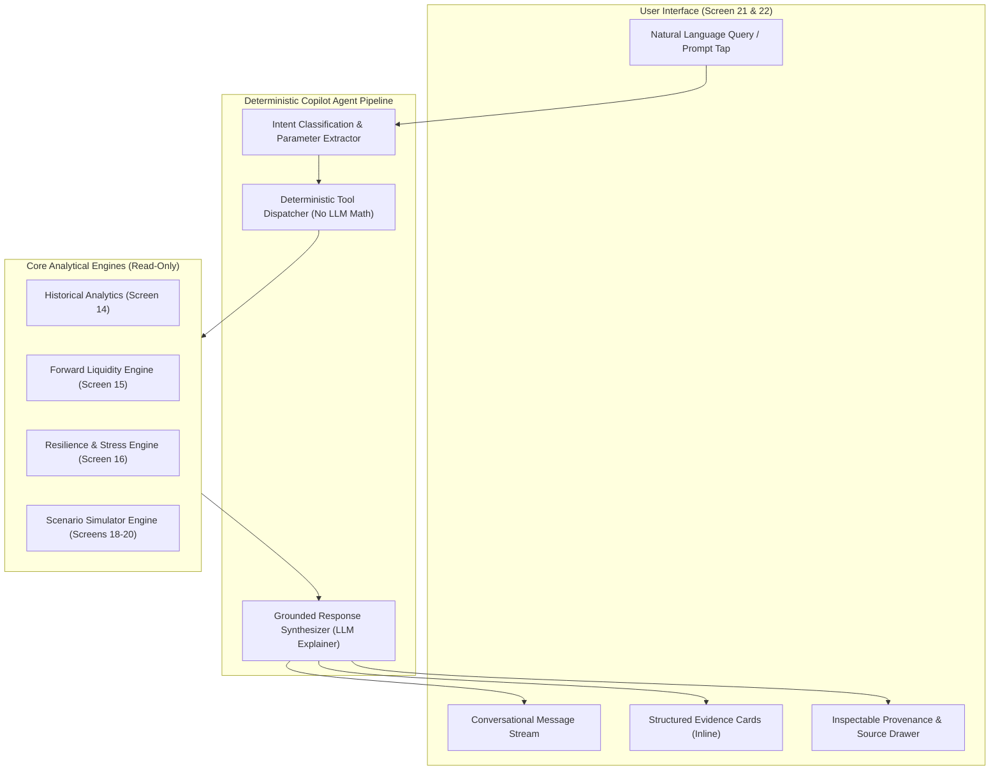

# Group E: Financial Copilot UI Specification (Screens 21–22)

> **Parent Specification:** `docs/00_master_ui_specification.md`  
> **Status:** Specification Finalized  
> **Platform:** Flutter Mobile (iOS & Android)  
> **Timeline Reference Anchor:** Today = Friday, 6 November 2026, 08:30 AM  
> **Core Architectural Principle:** The Copilot is an explainability and synthesis interface. It retrieves verified records and structured outputs from the Financial Intelligence Engine; it **never** invents financial numbers, performs standalone arithmetic, or hallucinates financial advice.

---

## 1. Group E Architectural Framework



### Copilot Invariants
1. **Deterministic Sourcing:** Every balance, date, percentage, or forecast value returned in chat is queried directly from the verified database or mathematical engine.
2. **Inspectable Provenance:** Every response includes an expandable citation drawer disclosing the exact data points, model version, and cutoff timestamps used.
3. **Sandbox Preservation:** Copilot cannot modify real records. If a user asks to *"reduce spending by ₹500"*, Copilot runs a hypothetical simulation in the sandbox.

---

## 2. Screen 21: Copilot Home (Analytical Prompt Catalog)

> **Headline:** *"Meet your financial copilot."*  
> **Subtext:** *"Ask questions. Understand your numbers. Explore your options."*

```
+--------------------------------------------------------------+
| [Eye Logo] Financial Copilot                         [History]|
+--------------------------------------------------------------+
| ANALYTICAL CONTEXT STATUS                                    |
| +----------------------------------------------------------+ |
| | ● Analyzing 3 accounts · 142 records · Baseline: 6 Nov   | |
| |   Current Liquid: ₹42,850 · 30d Lowest Dip: ₹24,300      | |
| +----------------------------------------------------------+ |
|                                                              |
| WHAT WOULD YOU LIKE TO EXPLORE?                              |
| Select a prompt or type your query below:                    |
|                                                              |
| AFFORDABILITY & WHAT-IF SHOCKS                               |
| +----------------------------------------------------------+ |
| | [ 💬 ] "Can I afford an unexpected ₹15,000 expense?"     | |
| | [ 💬 ] "What happens if my salary is delayed by 10 days?"| |
| +----------------------------------------------------------+ |
|                                                              |
| FORECAST & LIQUIDITY DIAGNOSTICS                             |
| +----------------------------------------------------------+ |
| | [ 💬 ] "Why does my projected balance dip around 10 Nov?"| |
| | [ 💬 ] "When will my cash balance be at its lowest?"     | |
| +----------------------------------------------------------+ |
|                                                              |
| SPENDING PATTERNS & HABITS                                   |
| +----------------------------------------------------------+ |
| | [ 💬 ] "Which spending categories increased this month?" | |
| | [ 💬 ] "How much did I spend on dining out in October?"  | |
| +----------------------------------------------------------+ |
|                                                              |
| COMMITMENTS & SAFETY BUFFER                                  |
| +----------------------------------------------------------+ |
| | [ 💬 ] "List all confirmed bills due before my salary."  | |
| | [ 💬 ] "How safe is my ₹15,000 emergency buffer?"        | |
| +----------------------------------------------------------+ |
|                                                              |
| +----------------------------------------------------------+ |
| | [ ⌨ Ask about your finances...                  ] [ 🎙 ] [ >]|
| +----------------------------------------------------------+ |
| [  Home  |  Activity  |  Insights  | Simulate |  Copilot ★ ] |
+--------------------------------------------------------------+
```

### Component Details
- **Header:** LiquidityLens abstract eye symbol (`24 × 24 px`, `#E5FF00`), title `"Financial Copilot"` (`22 px`, SemiBold, `#F5F5F0`), right action History icon (`20 px`, `#929292`).
- **Context Status Pill (`#161616`, radius `12 px`, padding `8 px 14 px`):**
  - Live green indicator dot (`#42D392`).
  - Text: `"Analyzing 3 accounts · 142 records · Baseline: 6 Nov 08:30 AM"`.
- **4 Analytical Prompt Categories:**
  - Grouped cards (`#141414`, radius `14 px`, border `1 px #222222`).
  - Tapping any prompt transitions immediately to Screen 22 and executes the query.
- **Bottom Input Container:**
  - Floats above bottom hybrid bubble navigation (`height: 52 px`, background `#1C1C1C`, border `1 px #2C2C2C`, radius `26 px`).

---

## 3. Screen 22: Copilot Conversation & Structured Evidence

> **Purpose:** Conversational chat stream pairing concise natural language synthesis with interactive, structured **Evidence Cards**.

```
+--------------------------------------------------------------+
| [ ← Back ] Financial Copilot                         [ Clear ]|
+--------------------------------------------------------------+
|                                                              |
|                                [ User Bubble · 8:32 AM ]     |
|              Can I afford an unexpected expense of ₹16,000?  |
|                                                              |
| [ Copilot Response · 8:32 AM ]                               |
| Based on your current tracked records, an unexpected         |
| outflow of ₹16,000 would cause your projected balance to     |
| breach your ₹15,000 safety buffer.                           |
|                                                              |
| +----------------------------------------------------------+ |
| | [ ⚡ ] SIMULATED CASH IMPACT             HYPOTHETICAL ⚠  | |
| | Tested Outflow:            ₹16,000 (One-time)            | |
| | Baseline Lowest Dip:       ₹24,300 (10 Nov)              | |
| | Simulated Lowest Dip:      ₹8,300  (12 Nov)              | |
| | Buffer Shortfall:          -₹6,700 below buffer          | |
| | Breach Duration:           12 days (12 Nov – 24 Nov)     | |
| |                                                          | |
| | [ VIEW DUAL-CURVE IN SIMULATOR → ]                       | |
| +----------------------------------------------------------+ |
|                                                              |
| Why this happens: Your Car Loan EMI (₹4,500) executes on     |
| 10 Nov. Adding this ₹16,000 outflow on 12 Nov pulls your     |
| balance down to ₹8,300 before discretionary burn recovers.   |
|                                                              |
| +----------------------------------------------------------+ |
| | [ 💡 Mitigation Option ]                                 | |
| | If you split this into 2 installments (₹8k now, ₹8k on   | |
| | 1 Dec after salary), your lowest balance remains         | |
| | ₹16,300, and your safety buffer stays protected.         | |
| +----------------------------------------------------------+ |
|                                                              |
| 🔍 [ Inspect Evidence & Data Sources (3 records · Engine v2.1) ▼ ]
|                                                              |
| FOLLOW-UP ACTIONS:                                           |
| [ Split into installments ]   [ What if salary arrives early? ]
|                                                              |
| +----------------------------------------------------------+ |
| | [ ⌨ Ask a follow-up question...                 ] [ 🎙 ] [ >]|
| +----------------------------------------------------------+ |
+--------------------------------------------------------------+
```

---

## 4. Four Specialized Inline Evidence Cards

To prevent "wall of text" responses and ensure data verifiability, the Copilot embeds structured cards:

### 4.1 Type A: Affordability & Simulation Card
- **Styling:** Dark card `#161616`, border `1 px #FFAD5544`, radius `16 px`.
- **Badge:** `HYPOTHETICAL SIMULATION` in amber text.
- **Metrics:** Tested Outflow, Baseline Dip, Simulated Dip, Buffer Shortfall, Breach Window.
- **Direct CTA:** `[ VIEW DUAL-CURVE IN SIMULATOR → ]` (Deep-links to Screen 20).

### 4.2 Type B: Forecast Driver Card
- Rendered when user asks: *"Why is my balance decreasing next week?"*
- Displays:
  - Upcoming Confirmed Obligations (e.g. Car Loan EMI ₹4,500 on 10 Nov).
  - Assumed Daily Discretionary Burn Rate (`₹410/day`).
  - Expected Inflow Date (`1 Dec · ₹35,000`).
- **Direct CTA:** `[ VIEW 30-DAY FORECAST → ]` (Deep-links to Screen 15).

### 4.3 Type C: Spending Category Breakdown Card
- Rendered when user asks: *"Which categories increased this month?"*
- Displays horizontal comparison bars comparing current MTD vs historical 30-day baseline.
- **Direct CTA:** `[ VIEW IN ACTIVITY → ]` (Deep-links to Screen 7).

### 4.4 Type D: Obligation Audit Card
- Rendered when user asks: *"What bills are due before salary?"*
- Displays itemized rows of confirmed commitments and unconfirmed AI-detected candidates with status chips.

---

## 5. Inspectable Evidence & Citation Drawer

Below every Copilot answer, an expandable drawer provides mathematical provenance:

```
+--------------------------------------------------------------+
| 🔍 [ Evidence & Model Provenance ]                   [ Hide ▲]|
|                                                              |
| • Model Version:       Prophet-Hybrid v2.1 (Calibrated)      |
| • Data Cutoff:         5 Nov 2026, 11:59 PM (142 txns used)  |
| • Baseline Query:      HDFC Salary Account (•••• 4012)       |
| • Underlying Records:  Car Loan EMI (Obligation ID: #OB-102) |
| • Discretionary Burn:  ₹410/day (derived from last 45 days)  |
+--------------------------------------------------------------+
```

---

## 6. Guardrails & Epistemic Boundaries

| User Scenario | Copilot Behavior & Enforced Response Guardrail |
| :--- | :--- |
| **Untracked Accounts** (e.g., *"How is my stock portfolio doing?"*) | *"LiquidityLens AI currently tracks liquid cash accounts (HDFC Salary, ICICI, Cash). Investment portfolios and external brokerage accounts are not connected."* |
| **Speculative Investing Advice** (e.g., *"Should I buy Bitcoin?"*) | *"I specialize in cash-flow foresight and liquidity buffer protection. I cannot provide investment, stock, or trading advice."* |
| **Ambiguous Date Context** | Prompts for clarification rather than assuming: *"Would you like me to simulate this expense for today (6 Nov) or a specific future date?"* |
| **Insufficient Historical Data** | Discloses limitations clearly: *"I have only 6 days of records for ICICI Credit Card. Cash-flow projections for that account have wider prediction intervals."* |
